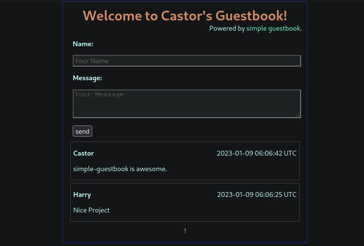
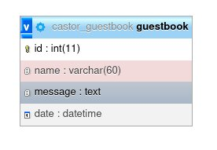

### Table of Contents
[What is simple-guestbook?](#simple-guestbook)  
[Features](#features)  
[Dependencies](#dependencies)  
[Configuration](#configuration)  
[Upgrading an existing install](#upgrading-an-existing-install)

# simple-guestbook

As it's name suggests, simple-guestbook is a super simple and lightweight guestbook made using php and mysql/MariaDB.  
Demo and preview at: <https://guestbook.yogeshlamichhane.com.np>.



# Features
- Minimal
- Ad and javascript free
- Easy to setup and use
- No 3rd party libs are used
- No login required
- simple captcha like verification process for anti-spam
- Spam protection: honeypot field, minimum fill-in time, per-visitor cooldown and a site-wide flood limit
- Full Unicode (emoji, CJK, accents) via utf8mb4

# Dependencies
- PHP 8.5 with the `mysqli` extension (older versions may work, but the latest version is recommended)
- MySQL 5.7+ or MariaDB 10.3+

# Configuration
1. Copy the example config and fill in your database details (`$hostname`, `$port`, `$hostuser`, `$hostpass`, `$dbname`). The title, messages per page, timezone and table name can be changed there too.

```
cp config.php.example config.php
```

2. Create the database and a user for the guestbook, with the utf8mb4 charset (full Unicode, including emoji). Many hosting panels do this for you; just pick utf8mb4 if asked.

```sql
CREATE DATABASE `<dbname>` CHARACTER SET utf8mb4 COLLATE utf8mb4_unicode_ci;
CREATE USER '<hostuser>'@'<hostname>' IDENTIFIED BY '<hostpass>';
GRANT SELECT, INSERT, CREATE ON `<dbname>`.* TO '<hostuser>'@'<hostname>';
```

On MariaDB 10.10 or newer you can use the more modern `utf8mb4_uca1400_ai_ci` collation instead of `utf8mb4_unicode_ci`.

3. Open the guestbook in your browser. On the first visit it creates its table (utf8mb4, InnoDB) and is ready to use. The `CREATE` privilege is only needed for that first visit; afterwards you can remove it:

```sql
REVOKE CREATE ON `<dbname>`.* FROM '<hostuser>'@'<hostname>';
```

<details>
<summary>Prefer to create the table yourself?</summary>

```sql
CREATE TABLE `<dbname>`.`<tablename>` (
    `id` INT NOT NULL AUTO_INCREMENT PRIMARY KEY,
    `name` VARCHAR(60) NOT NULL,
    `message` TEXT NOT NULL,
    `date` DATETIME NOT NULL DEFAULT CURRENT_TIMESTAMP
) ENGINE=InnoDB DEFAULT CHARSET=utf8mb4 COLLATE=utf8mb4_unicode_ci;
```

Then the user only needs `GRANT SELECT, INSERT ON <dbname>.<tablename> TO ...`.

The table should look like following:


</details>

4. Web server: on Apache the included `.htaccess` hides dotfiles, `.git`, SQL dumps, `migrations/` and the PHP include files. On nginx, add the equivalent rules yourself, for example:

```nginx
location ~ /\.(?!well-known/) { return 404; }
location ~ (^/migrations/|\.sql$|^/(config\.php|config\.php\.example|variableAndFunctions\.php|setup\.php)$) { return 404; }
```

# Upgrading an existing install
Keep your existing `config.php`; it works unchanged with the new code. Settings it doesn't have (such as `$port`) get defaults, and the database connection behaves exactly as before.

Older versions created a `latin1` table and stored messages escaped twice (an apostrophe showed as `\&#039;`, line breaks as `\r\n`). [migrations/2026-11-02-utf8mb4.php](/migrations/2026-11-02-utf8mb4.php) converts the table to utf8mb4 and repairs those messages:

1. Back up the table: `mysqldump <dbname> <tablename> > before-utf8mb4.sql`
2. Dry run, which lists every message it would change: `php migrations/2026-11-02-utf8mb4.php`
3. Migrate: `php migrations/2026-11-02-utf8mb4.php --apply`

Nothing to change in `config.php` afterwards: the guestbook sees the utf8mb4 table and switches its connection to utf8mb4 by itself. The original table is kept as `<tablename>__latin1_backup`. To roll back:

```sql
RENAME TABLE `<tablename>` TO `<tablename>__bad`, `<tablename>__latin1_backup` TO `<tablename>`;
```

Once everything looks right, you can drop the backup table.


**This repository is available in following platforms:**   
<https://git.sr.ht/~whoisyoges/simple-guestbook>   
<https://codeberg.org/whoisyoges/simple-guestbook>   
<https://github.com/whoisyoges/simple-guestbook>
